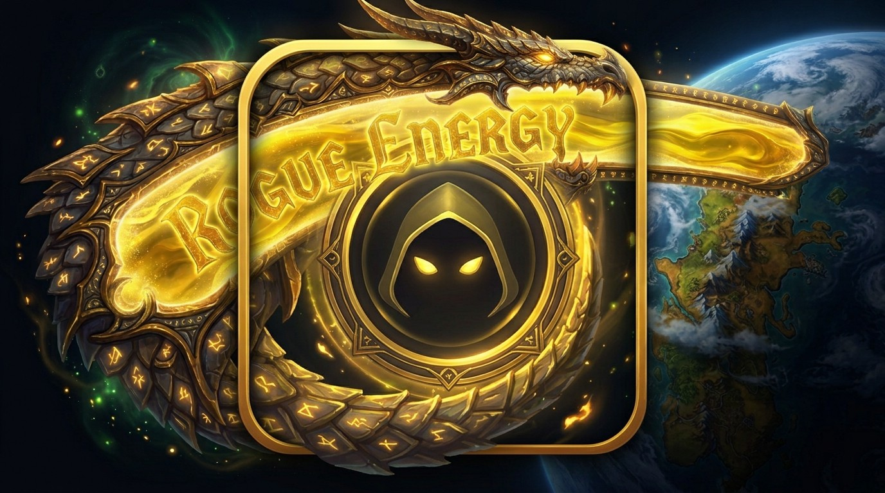
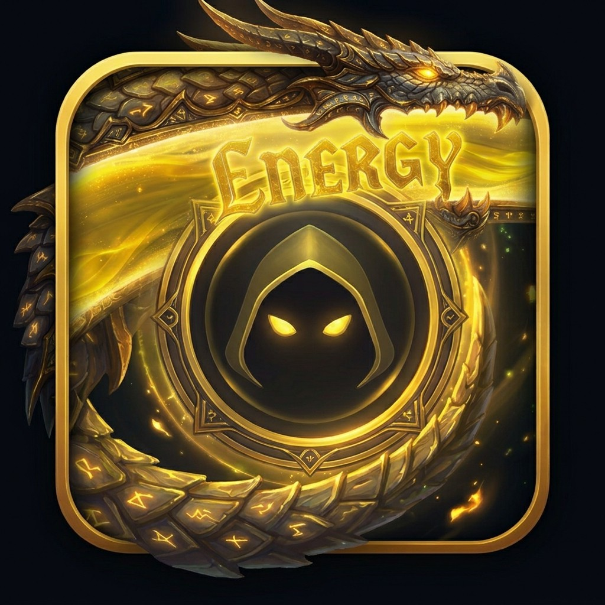

# RogueTick

A minimal rogue UI for **WoW Forever** (Combat rogue first). Muted colours, thin borders, little noise. Each colour stands for one action, so you can read the fight at a glance.

## Features

- **Energy bar.** Smooth regen, a cap line, and a shadow that shows your energy one GCD ahead. It works even when the game hides values in combat.
- **Combo advice.** Combo cells take the colour of the next action: blue for Sinister Strike, orange for Slice and Dice, red for Eviscerate, grey for wait. From stealth it suggests an opener: Ambush, Cheap Shot or Garrote.
- **Defence cell.** Suggests Kick, Disarm, Evasion, Vanish, a potion or Feint. Kick and Disarm share a teal border.
- **Kick timing.** A dark "too late" zone at the end of the target's cast (ping-aware). The cast turns grey when it can't be interrupted or Kick won't be ready in time.
- **Player and target frames.** Health, power, cast bar and buffs/debuffs.
- **Fight summary.** One line after each fight: duration, Slice and Dice uptime, successful Kicks, energy lost at cap.
- **Nameplates.** Colour tells you *who* it is, length tells you how much health is left:
  - enemy players use class colours;
  - hostile mobs are red, neutral mobs yellow;
  - allies show their name only;
  - raid marks are shown;
  - low health brightens the bar, and below 15% it pulses.
- **Poison bar.** Two small buttons, one per hand. Left-click applies the poison, right-click picks one from your bags. Each button can have its own key, and Ctrl+drag moves the bar.
- **Profiles.** Account-wide profiles you can apply on any character.

## Install

Copy the folder to `World of Warcraft/_forever_/Interface/AddOns/RogueTick/` and restart the client.

## Commands

| Command | Action |
|---|---|
| `/et config` | settings |
| `/et test` | test mode (shows every indicator) |
| `/et lock` | lock / unlock frames |
| `/rth` | unit-frame options |

## Feedback

Found a bug or have an idea? Open an [issue](https://github.com/PsyMoss/RogueTick/issues) or start a [discussion](https://github.com/PsyMoss/RogueTick/discussions). Russian or English, both are fine. For bugs, a screenshot and the BugSack error text help a lot.

---

